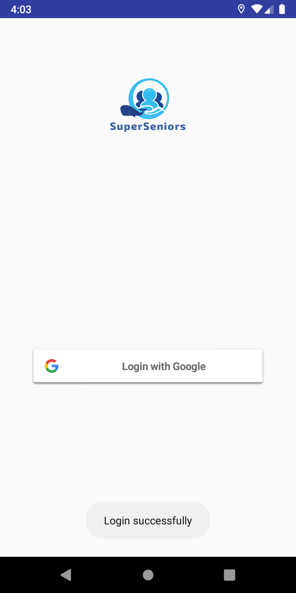
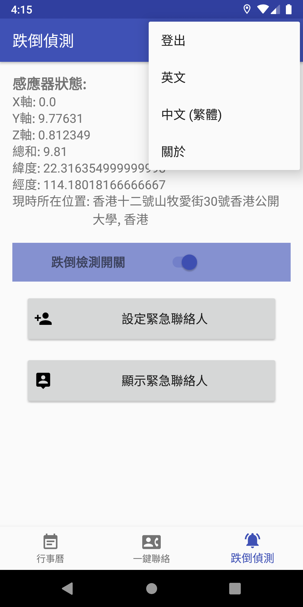
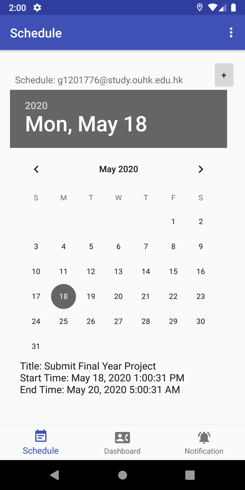
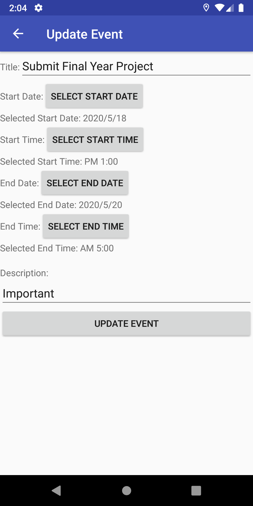
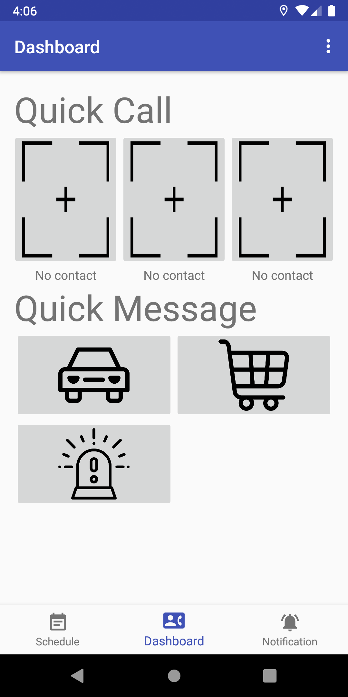
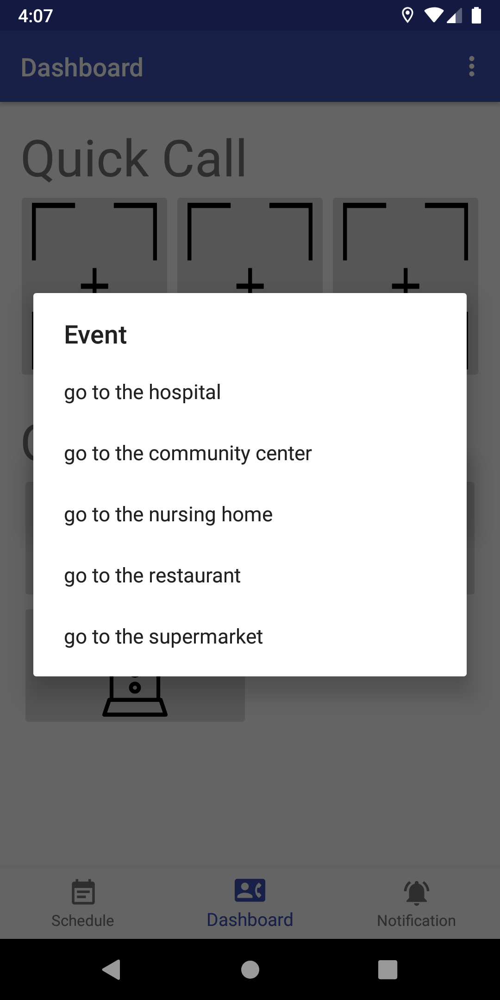
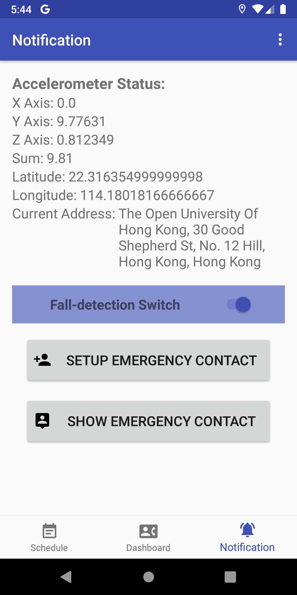
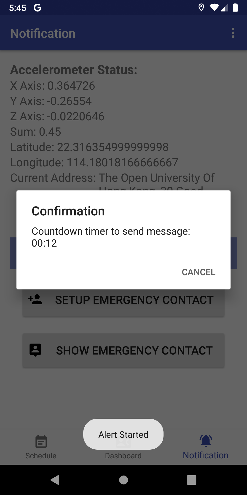

#  SuperSeniors

> **The Open University of Hong Kong 2019/20 Final Year Project**
> 
> **Elderly Mobile Life Assistant:** A safety-centric Android ecosystem providing real-time fall detection, GPS monitoring, and simplified family communication for extra peace of mind.

[](#) &nbsp;
[](#) &nbsp;
[](LICENSE) &nbsp;

## Project Mission
**SuperSeniors** was born from a critical need: ensuring the safety of the elderly in a rapidly aging society. This project focuses on minimizing response time during emergencies by bridging the gap between fall detection and family navigation.

### Core Focus Areas
1. **Safety First:** Robust fall detection algorithm with zero-latency alert triggers.
2. **Instant Navigation:** Direct GPS routing to the elderly member's exact location.
3. **Accessibility:** An intuitive, high-contrast UI tailored for seniors with simplified touch interactions.

## Key Features
### Emergency & Safety
* **Fall Detection System:** * Real-time monitoring using accelerometer data.
    * Visual & Auditory countdown alert when a fall is detected.
    * Automatic SMS broadcasting with **Google Maps** coordinates to emergency contacts upon timeout.
    * **High Availability:** Background service persists even if the application is closed.
* **GPS Monitoring:** Continuous location tracking during emergency states to guide family members.

### Smart Communication
* **Single-Touch Dialing:** Automated persistent dialing logic to ensure connection with family members.
* **One-Tap Instant Messages:** Pre-set SMS templates for quick status updates (e.g., "I'm safe", "Need help").

### Daily Living Assistant
* **Google Calendar Integration:** Syncs daily to-do lists and medical appointments via Google API.
* **Social Authentication:** Secure and easy login via **Firebase Google Auth**.
* **Localized Support:** Fully supports English and Traditional Chinese (繁體中文).

## Installation & Setup
Please refer to the detailed **Installation Guide** for environment configuration and API key setup.
* **Installation Guide:** `doc/installation_guide.pdf`
* **Project Documentation:** See `/doc` for the full Final Report and Presentation.

## Screenshots
| Login Page     | Multi Language   |
| :-------------: | :-------------: |
|  |  |

| Daily Calendar Page    | Update Event   |
| :-------------: | :-------------: |
|  |  |

| Quick Contact Page    | Instant Messages   |
| :-------------: | :-------------: |
|  |  |

| Fall Detection Page    | Detected Fall Action   |
| :-------------: | :-------------: |
|  |  |

## Demonstration
- For more information of the project demonstration, please click [here](https://youtu.be/TJ6ovmJW0uA) to watch the following video.

[](https://youtu.be/TJ6ovmJW0uA)

## License
- SuperSeniors is released under the [Apache Version 2.0 License](http://www.apache.org/licenses/LICENSE-2.0.html).
```
Copyright 2020 WhaleDidYouGo

Licensed under the Apache License, Version 2.0 (the "License");
you may not use this file except in compliance with the License.
You may obtain a copy of the License at

   http://www.apache.org/licenses/LICENSE-2.0

Unless required by applicable law or agreed to in writing, software
distributed under the License is distributed on an "AS IS" BASIS,
WITHOUT WARRANTIES OR CONDITIONS OF ANY KIND, either express or implied.
See the License for the specific language governing permissions and
limitations under the License.
